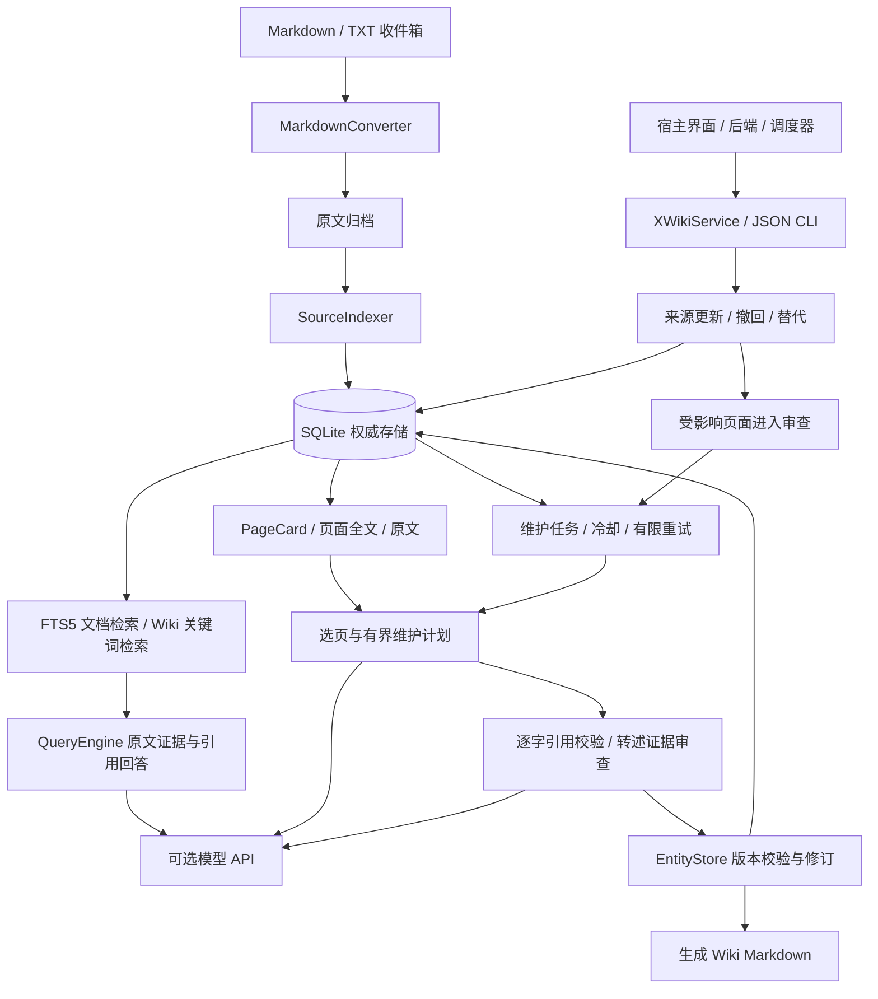

# XWiki 架构与运行路径

本图对应现有实现。界面、后端与调度器接入由宿主负责；下述 online/offline/shared 是逻辑职责，没有三个独立服务或数据库。

## 摄取与存储

`service.py` 管理工作区、摄取、查询和维护入口；`converter.py` 生成正文、页和内容指纹。原始资料先归档，索引成功后再消费收件箱。`indexer.py` 写入来源元数据、页正文与 FTS5。同 ID 内容变化保存旧正文快照；新 ID 的来源替代必须明确建立关系。

`db.py` 完成兼容升级。SQLite 是权威存储，`wiki/entities/` 中的 Markdown 是投影，不通过编辑文件直接改数据库。保存前检测外部文件修改；写文件失败时恢复数据库与已写文件。文件系统和数据库不是跨资源事务，进程或机器在写入中断电仍需要结构检查和恢复。

## 维护

`maintenance.py` 从待处理资料和文章建立任务，选页、读取全文、产出完整正文与引用计划。来源、选择和输出都有数量或字符预算。`evidence.py` 对引用片段和上下文校验，原文复制可直接通过，转述需要模型判断。模型判断仍可能误判，因此评测不能只看引用 ID 是否存在。

`entities.py` 对文章使用乐观版本校验，并保存关系和修订。旧事实与引用必须保留的自动维护规则，和来源变化的审查状态，共同阻止静默覆盖。`sources.py` 在一个 SQLite 事务中记录状态事件、标记关联文章并撤销旧执行令牌。

## 检索与问答

`searcher.py` 先执行词法检索，再筛查来源状态与引用有效性。被撤回、替代或证据待审的文章可以明确读取，但不进入当前问答；跳过失效结果后继续查找有效文章。`agent/query.py` 再次检查证据，限制上下文，并校验回答引用定位。

检索期间来源仍可能被其他进程修改；当前没有覆盖整个模型调用的数据库快照隔离。生成引用格式有效也不等于语义得到证据支持。

## online / offline / shared

- **offline：**本地摄取、词法检索、证据读取、结构检查、来源状态、修订和回滚。公开示例中的维护计划由脚本模拟，不是离线真实模型。
- **online：**有配置时调用模型生成回答、抽取与编译、规划维护和审查转述。这里指模型调用能力；自托管本地模型同样可用，不要求公共互联网。
- **shared：**两种执行路径复用配置、工作区、数据库、公共模型、证据校验和版本接口。它不代表多人共享知识库或跨用户记忆。

完整设计理由见 [设计决策](decisions.md)，产品边界见 [范围说明](scope.md)，复现材料见 [运行证据](verification.md)。
