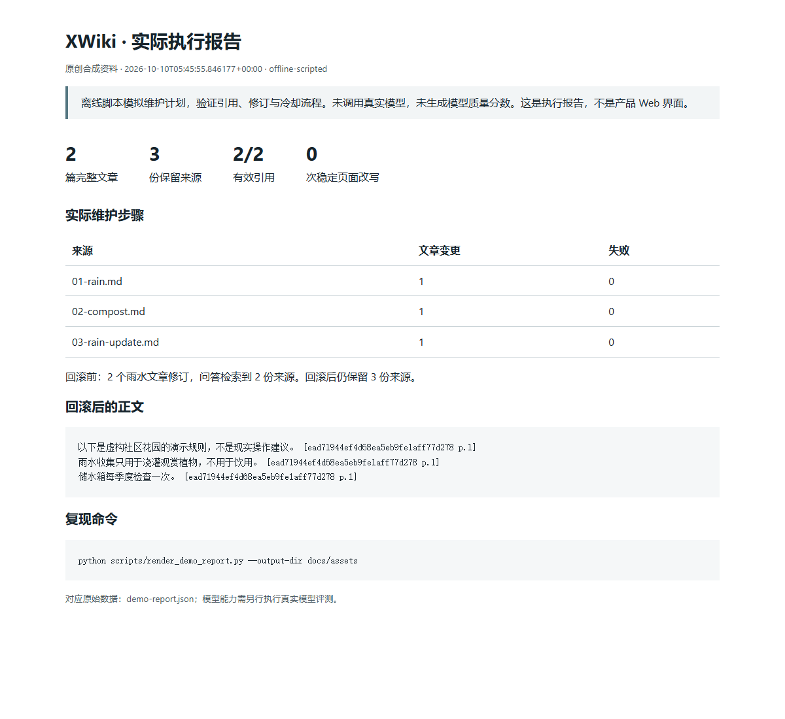

# 运行证据与复现

本页截图来自实际执行的公开社区花园示例报告，不是产品 Web 界面，也不是模型质量成绩。维护计划由脚本复制来源原文，运行过程无网络模型调用。



截图对应 [HTML 报告](assets/demo-report.html)与 [JSON 数据](assets/demo-report.json)。数据只由原创合成资料生成，保存两个主题、三份来源、引用校验、稳定页面零改写和回滚后的正文。报告时间戳为 UTC；本次运行对应 2026-10-10 上海时间。临时知识库已清理，没有将真实用户资料或本地绝对路径提交到截图数据。

## 重放演示

```bash
python -m pip install ".[test,quality,build]"
python scripts/demo_wiki.py
python scripts/render_demo_report.py --output-dir data/demo-docs
```

如需重新制作截图，浏览器工具仅用于文档，不是运行时依赖：

```bash
npm install --no-save --prefix data/browser-tools playwright
node data/browser-tools/node_modules/playwright/cli.js install chromium
node scripts/capture_demo_report.cjs --playwright-module ./data/browser-tools/node_modules/playwright --directory data/demo-docs
```

也可以用 `--browser-path` 指向已安装的 Chromium/Edge。本次截图使用无界面 Edge 和 1200×1100 视口，截取整个 HTML 页面；不同系统字体可能影响换行。

## 验证实现

```bash
python -m ruff check xwiki scripts tests
python -m mypy
python -m pytest -q --cov=xwiki --cov-report=term-missing
python -m build
python scripts/check_distributions.py dist
```

[来源生命周期实现的 CI](https://github.com/CY202227/xWiki/actions/runs/38027863167)已验证 Windows/Linux 与 Python 3.10/3.14。覆盖率描述测试执行范围，不是知识正确率。真实模型评估脚本位于 `scripts/evaluate_*.py`，参数与数据集由各自 `--help` 指定。

当前公开样本很小。通过这份演示不意味着完成大型知识库、复杂文档解析、多模态识别或长期模型维护能力验证；范围见 [产品说明](scope.md)。
